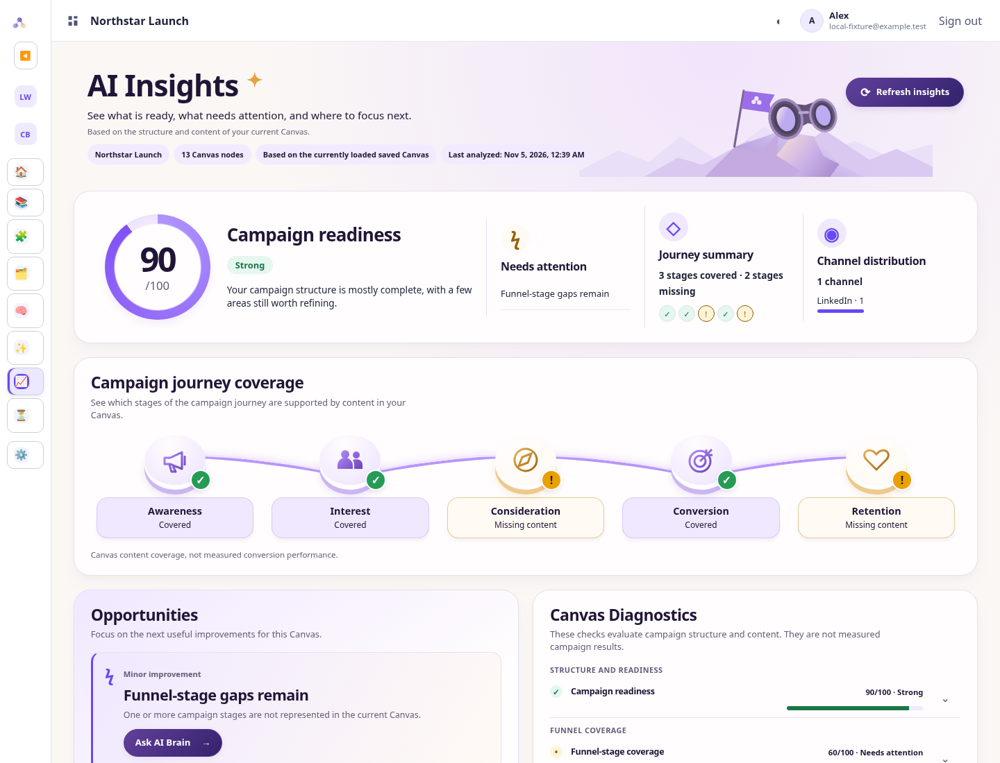
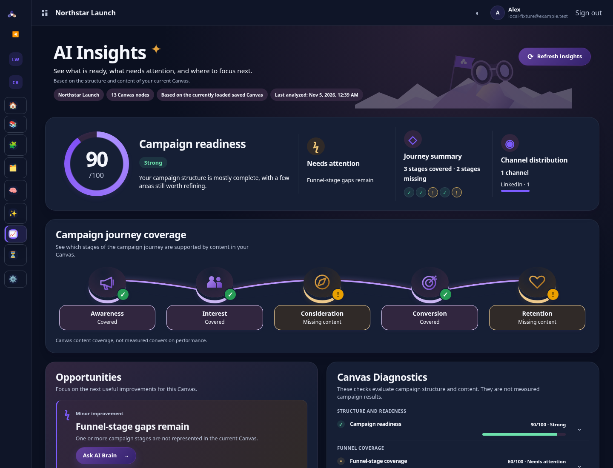
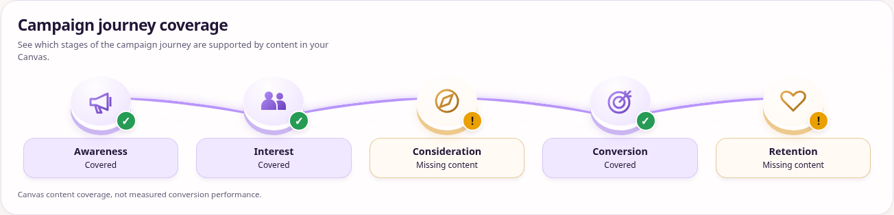
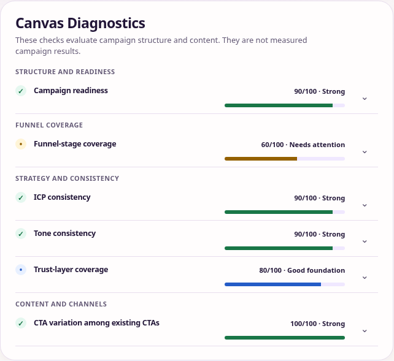
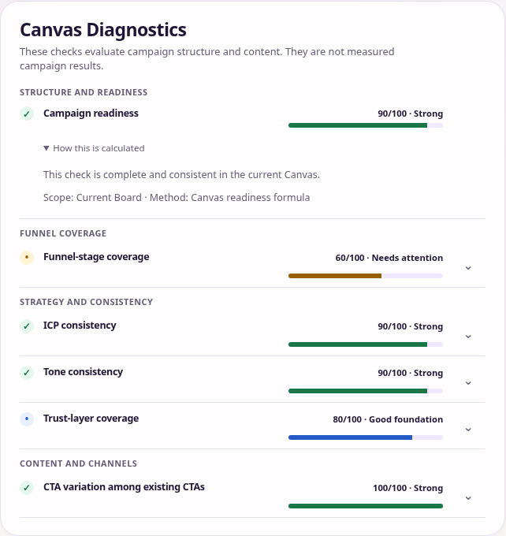

# BW-43 — AI Insights 2.0 visual redesign

AI Insights now presents existing Canvas diagnostics as a compact campaign progress dashboard. No scoring, analysis, provider, persistence, permission or API contract changed. The implementation starts from merged main `978833e`.

The complete pre-edit data-point and dependency inventory is in [bw43-insights-inventory.md](bw43-insights-inventory.md). It includes every visible field, six diagnostic calculations, four groups, finding conditions and ordering, methodology, freshness ownership, interactions and pre-existing limitations.

## Presentation

- Full-width header retains both original explanations, current Board, node count, saved/live context, localized timestamp and Refresh insights. A small local SVG supplies the decorative landscape/binoculars.
- The overview uses the actual readiness score in a larger ring, its original classification and explanation, all existing attention links, covered/missing summary, and every existing channel count. The status badge follows the existing threshold, including lower scores.
- Campaign Journey is a connected path of five existing stages. Simple vector masks and raised platforms distinguish covered and missing content. Names, accessible status, ordering and the structural-coverage disclaimer are unchanged. On mobile it becomes a vertical path.
- The most important existing opportunity receives stronger visual emphasis. Every other source finding remains visible in its original order with severity, description, affected-node preview and applicable actions. There is no new opportunity limit, sorting, analysis or expansion action.
- Diagnostics retain all four group headings and six actual scores/classifications. Numeric bars use those scores only. Each original native calculation disclosure retains its accessible “How this is calculated” label. Compact desktop rows use its chevron; the full label appears when expanded and in the stacked layout. The original explanation now lives inside that same disclosure alongside the original scope/method text.
- Measured Performance and Data and Methodology use compact adjacent cards, with their original native disclosures and complete content. No chart, connection action, integration, fabricated measurement, View all, View details, trophy or reward was added.

Readiness appears prominently above and compactly in Diagnostics because those sections serve orientation and calculation review respectively. Journey repeats as summary counts, a stage map, a numeric diagnostic and an actionable gap finding. Source context remains in the header and full methodology. These repeated values still come from the same existing snapshot; repeated large paragraphs are avoided.

## Files and scope

| File | Change |
| --- | --- |
| `app.js` | Four existing renderer lines changed: readiness status styling attribute; decorative stage spans; numeric diagnostic bars and original-copy placement within existing details; reduced-motion behavior for the existing attention scroll action |
| `styles.css` | Scoped `#insights-view` dashboard composition, Light/Dark colors, progress path, compact disclosures, responsive and accessible treatments; existing unrelated styles remain untouched |
| `assets/insights/summit.svg` | Small authored decorative vector; no remote asset or generated image dependency |
| `scripts/check-bw43-insights-browser.js` | Actual application/engine/render/actions; fictional Canvas fixtures; 48 combinations of themes, languages, navigation and viewport sizes |
| `scripts/check-bw43-native-zoom.js` | Actual Chromium 200% browser zoom through its local Settings API, disposable profile, reflow and keyboard checks |
| `scripts/check-bw36-6-workspace-schema-foundation.js` | Advances the exact full-file CSS fingerprint for the approved scoped visual addition; every assertion and other pin stays unchanged |
| `scripts/check-bw36-7r3-corrected-workspace-backfill-preflight.js` | Advances the dependent test-source fingerprint; all historical SQL and runtime pins/assertions remain |
| `package.json` | `check:bw43` registration; no dependency added |
| `.github/workflows/runtime-boot-safety.yml` | Adds the new acceptance checks and fictional screenshot artifact to both existing PostgreSQL versions; no prior check removed or weakened |
| `docs/implementations/bw43-insights-inventory.md` | Complete pre-edit audit |
| `docs/implementations/bw43-ai-insights-redesign.md` | Implementation, evidence, review and limitations |
| `docs/implementations/bw43-visuals/*` | Reviewed actual-browser screenshots and bounded validation summaries |

Byte-for-byte comparison against the base confirms unchanged `analyzeCampaign`, `calculateInsightsDiagnostic`, `captureInsightsDiagnostic`, `buildInsightsFindings`, `isCurrentInsightsSnapshot`, `askAiBrainAboutFinding` and `showInsightsFindingOnCanvas`. All existing DOM IDs, finding IDs, listeners and native details remain available. Only rendering/layout changed. The existing attention action now also honors reduced motion.

## Validation

The new browser suite uses the production application, deterministic engine and rendering/actions. Its existing shared fixture blocks provider/analytics endpoints and asserts no writes. Fictional test data includes a 13-node Board with readiness 90, three covered/two missing stages, and diagnostics `[90, 60, 90, 90, 80, 100]`.

Checks cover real scores and classifications; original priority/order; all diagnostic groups, scores and explanations; native calculation/methodology expansion; all six source classifications and seven methods; multiple/zero channels; multiple/no opportunities; Refresh; Canvas focus/select and editable AI Brain handoff without submission; saved/unsaved context; unavailable, malformed, stale, loading, empty, denied and no-Board states; public/viewer action suppression; no fabricated actions; EN/DE; Light/Dark; expanded/collapsed navigation; 1672/1440/1150/768/375/320px widths; keyboard focus and navigation clearance; reduced motion; equivalent CSS reflow and native 200% browser zoom.

Native zoom is verified independently from pinch scaling: actual 1440px browser window, 720px CSS viewport, DPR 2, visualViewport.scale 1. It checks disclosure access and reflow, then deletes its disposable browser profile. No application setting changes.

Local existing regressions pass: BW-25 baseline and dynamic translations; BW-28 architecture (86 contracts), UX/handoff (39), premium presentation and runtime rendering (46); shared BW-36.21B2 Home/Insights/Brain (30 groups, including 20,000-node source parity). The first full matrix found the historical whole-file CSS fingerprint, which necessarily changes with this approved redesign. Its expected digest was advanced, retaining the full hash assertion and all SQL/auth/sidebar pins. Original CSS bytes are unchanged, with only the scoped BW-43 block appended. Complete Runtime Boot Safety results for PostgreSQL **17.6** and **18.4** are recorded in the PR's checks and final validation report. The workflow retains all existing Insights, Canvas, AI Brain, Profile and boot checks.

Height comparison uses the same fictional 13-node Canvas, 1440×1100 viewport and original `origin/main` app/CSS versus the redesign: **2239 → 1604px**, about **28.4% shorter**. This is a desktop comparison for that fixture; actual height varies with findings, channel names, localization and disclosures. No essential data is hidden to achieve the reduction.

## Actual-browser evidence

Screenshots below are implementation evidence, not additional design references. See [bw43-visuals](bw43-visuals/) for all required cases.

Additional evidence includes multiple opportunities, multiple channels, no opportunities, honest disconnected performance, full methodology, tablet, 375px, 320px and native 200% zoom.

## Comparison with the approved mockup and remaining limitations

The hierarchy, ring, connected journey, lavender/ivory surfaces, warm missing-stage treatment, emphasized opportunity and adjacent diagnostic/disclosure cards follow the single approved Light mockup. Lightweight vector shapes replace its detailed 3D illustration. The existing shell remains unchanged. Original copy is retained, including longer titles, full channel counts, all opportunities and methodology; their height can exceed the one-opportunity mockup. No Connect analytics or new View details/View all action is introduced.

The original engine's stage inference, classification exceptions, score semantics and bounded finding/node/channel previews remain authoritative. The inventory documents pre-existing inconsistencies, including unconditional readiness explanation and the attention trust-code lookup, separately from this visual work. No functional defect is repaired beyond honoring the user's reduced-motion preference on the existing attention scroll interaction. Current performance is an honest disconnected disclosure because the existing renderer has no verified-performance branch.

## Codex review and publication

Codex self-review checked unchanged formulas, provenance, identities, freshness guards, permissions and handoff functions; preserved IDs/events/disclosures; no network/write boundary introduced; numeric-only progress bars; keyboard targets and focus; responsive wrapping and navigation clearance; Dark colors and selectors confined to Insights. No outstanding redesign correctness finding was identified after the browser checks. This is self-review, not an independent reviewer approval.

Before publication, documentation, SVG and screenshots were checked for secrets, real customer content, confidential operational detail and unexpected files. They contain only fictional test fixtures and repository-level implementation information. Scratch logs, browser profiles and dependency directories are excluded. User instructions authorize this PR publication; no additional publication approval is required by repository instructions. Exactly one normal PR is opened against `main`; no merge or manual deployment is performed.
