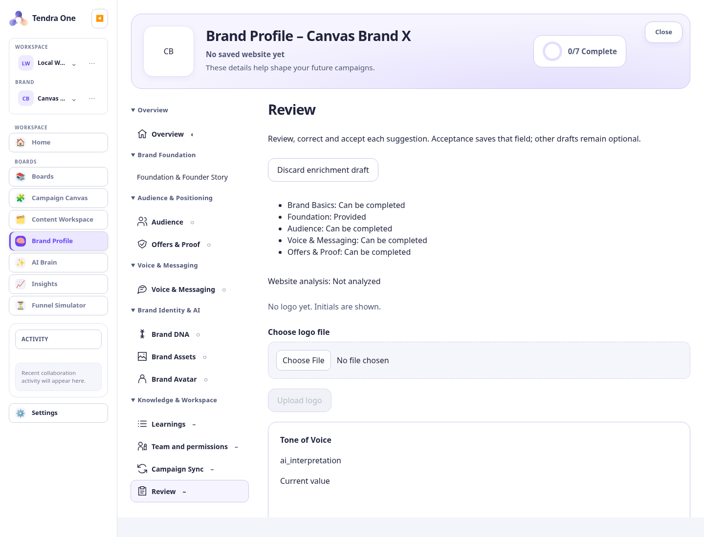
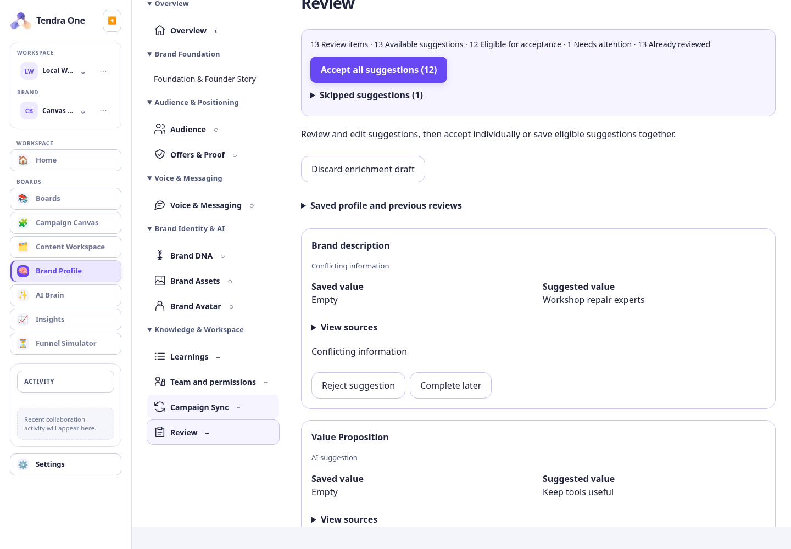
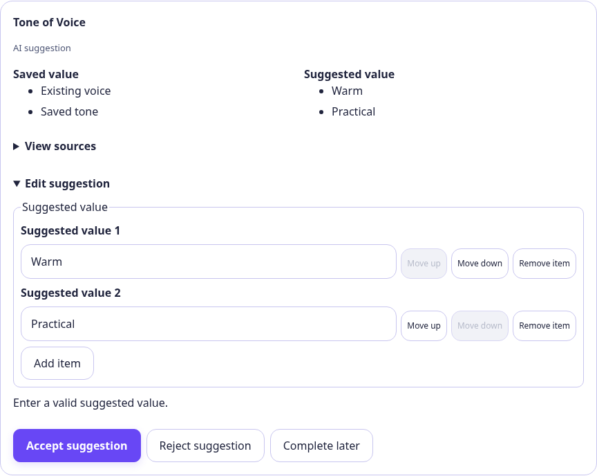
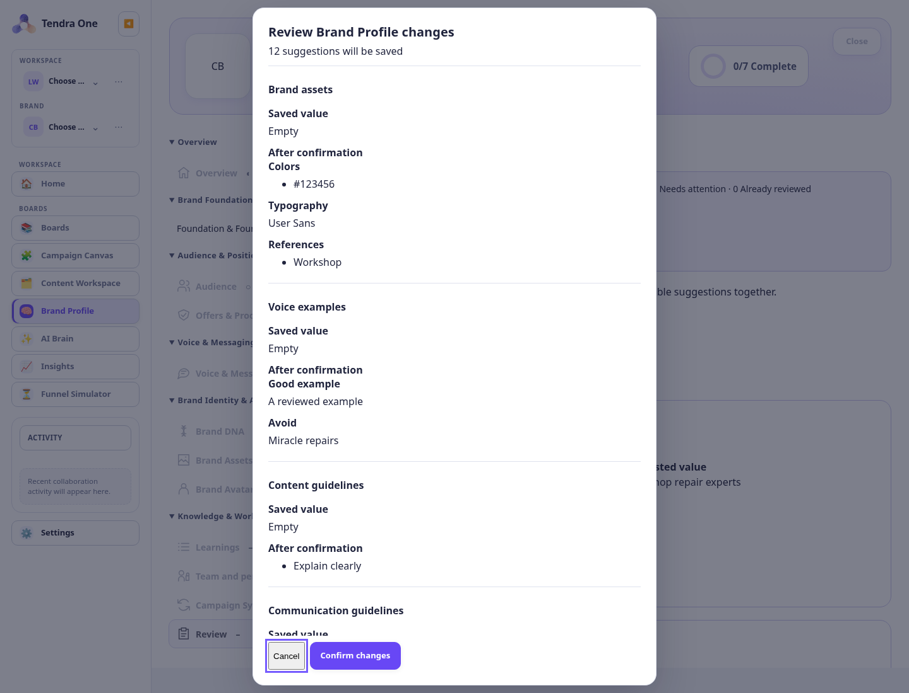
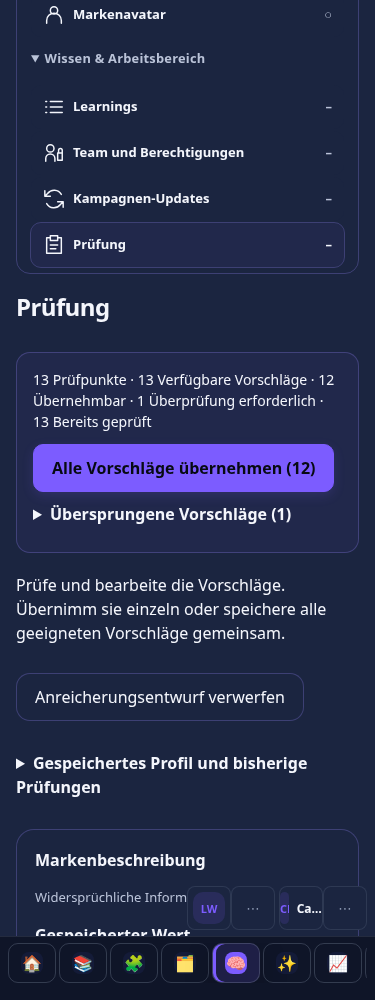

# BW-46.6 — Brand suggestions review and atomic acceptance

Base: `41a08fe`, latest merged main including PR #865. Dedicated branch: `bw46-6-brand-suggestions-review-ux`. All test brands, sources and providers are fictional. No inference, provider, database schema, special approval owner, merge or deployment is added.

## Problem and inspection

Review previously used JSON textareas for arrays/objects, repeated full-length cards with exposed classification identifiers, and a native destructive-write confirmation containing JSON pointers and private provenance. Every decision had its own save; there was no collective acceptance.

Read AGENTS.md, the BW-46 completeness audit/field integrity matrix and BW-46.2/46.3/46.5 implementation reports. Traced the production enrichment handler/contract, guided controller/rendering/CSS, language map, `app.js` mount/caching/context and Advanced options seams, canonical reader, protected preview/PUT/GET and existing browser/PostgreSQL protection fixtures. Existing section indexes, DOM IDs, field bindings, legacy website analysis, Founder/DNA/Avatar/Logo/Learnings owners and campaign snapshot boundaries remain in place.

The flow is: explicit production enrichment → version/Brand/revision validation → reviewable fields → typed local edits → shared eligibility/adoption plan → one candidate core → canonical command with captured revision/expected values and atomic evidence replacement → existing protected server preview if required → scoped explicit dialog → existing token-bearing PUT → authoritative no-cache GET → exact core/name/revision comparison → retire only confirmed decisions. Reload does not rebase stale proposals over newer saved data.

## Editors and review

| Fields | Suggestion editor |
|---|---|
| Description, Value Proposition, mission/vision/values | Textarea |
| Tone, messaging pillars, guidelines, keywords | Individually labeled string rows; add/edit/remove/move up/down |
| Personas | Separate name/description inputs; add/remove audience |
| Do/don't | Separate editable string lists |
| Voice examples | Separate good/avoid textareas |
| Assets | Separate colors/references lists and typography text; canonical domain and unknown siblings preserved |

The supported shape is validated with the existing enrichment validators. Length-invalid typed drafts survive navigation and remain correctable in the same editor. Field errors disable individual adoption and exclude that edit from collective adoption; editing does not persist comma-separated strings in place of arrays. Unsupported proposals/current shapes and ambiguous or specialized modules show a reason and retain access to Advanced options. General adoption does not replace approved Founder/DNA/Avatar or specialized module data.

The older profile checklist/logo controls and saved review history remain accessible in a compact disclosure when an enrichment draft is present; the legacy-only Review retains its original layout. Missing/unavailable items start as compact disclosures, so absent fields do not dominate actionable suggestions. Cards show saved and proposed values side by side on desktop, stacked on narrow screens. The proposed summary updates with local edits. Expandable source disclosures retain excerpts, attribution and sanitized HTTPS source links. Classification labels distinguish AI suggestion, website-supported, description-based, conflicting, missing and unavailable information in EN/DE. Evidence history uses the same friendly classification mapping. Accept is primary; Reject and Complete later remain alongside it. Structured edits are in a disclosure; plain text remains immediately editable. Reordering is provided for string lists; personas keep their existing add/remove pattern.

The review header distinguishes total review items from available suggestions, eligible, attention and previously reviewed counts. Missing/unavailable placeholders are review items, not available suggestions. “Accept all suggestions” / “Alle Vorschläge übernehmen” includes the exact eligible count. Exclusion names/reasons remain inspectable and update after edits. Zero eligible items disables acceptance with an explanation. Missing/empty values, conflicts, unavailable/unsupported targets, invalid edits, stale revisions, dirty manual baselines, missing edit permission and protected specialized modules cannot be silently adopted.

## Atomicity and protected confirmation

`BrandEnrichmentContract.plan` visits supported decisions in a stable key order, applies the existing `adopt` semantics to one in-memory copy, and returns eligible keys plus explicit exclusions. New module identities are cached per draft, so preview rerenders and response-loss retries preserve the original command and mutation receipt. The controller uses that candidate directly for bulk acceptance; it never loops over the single-field save method. Arrays remain arrays; nested asset siblings, plain module identities, original proposals, edited values, source lineage and input-reference pruning retain the existing contract.

One `profile_edit` command carries the accepted values and one whole-namespace evidence change. The existing writer keeps expected-value checks, revision checks, command size limits, mutation receipts, review tokens, authorization, transaction and history behavior. There is no second persistence mechanism. A server-rejected request preserves the saved core and pending decisions. A response lost after commit is resolved through the original idempotency receipt rather than another revision. A mismatched/missing readback does not report success: it retains the draft and requires synchronization. Only confirmed own writes advance remaining proposals to the new revision.

The writer's confirmation callback now also receives the actual server preview as its second argument; its original first argument/default behavior remain compatible. Only the enrichment mount supplies the new friendly callback. It checks that the server's changes equal the submitted command, derives before/after fields from that preview, shows exclusions and requires explicit Confirm changes or Cancel. It never renders internal pointers or the evidence payload. The existing writer retains and submits the server-generated token. No required confirmation is suppressed. Native confirmations for unrelated writers, manual profile edits and logo workflows keep their established behavior.

The native in-app dialog has an accessible name, initial Cancel focus, Escape cancellation, Tab containment, context-change cancellation, a labeled change-list region that supports keyboard scrolling, and visible header/actions. A revoked permission is still rejected by the server even after preview/confirmation. Brand/account/workspace context changes during confirmation cancel the review before dispatch. Individual rejection/postponement records metadata without replacing saved values; duplicate-module values remain unavailable rather than breaking their decision dialog.

## Implemented screenshots

Actual Chromium captures of fictional data; these are application screenshots, not mockups. Additional EN/DE, desktop/320/375px, light/dark captures are generated under `work/bw46-6/screenshots/` and uploaded by Runtime Boot Safety.

Before, with serialized array/object editors:

After, compact review header and comparison:

Typed list editing:

Protected server-preview confirmation:

German, dark theme, mobile:

## Regression coverage

| Required scenarios | Production-path evidence |
|---|---|
| All 13 field types; mixed/empty/nonempty; nested preservation and edited values | New controller suite; actual browser generation and typed controls; existing field-binding ledger |
| Invalid/conflicting/missing/unavailable/specialized/stale/permission exclusions | Shared plan/controller tests; browser invalid edit gating; existing duplicate-module browser now also rejects a module through the new dialog |
| Individual accept/reject/later, remaining proposals, bulk acceptance | Existing BW-46.2/46.3 browsers plus new controller/browser suites |
| Exactly one write/revision/history event, one required confirmation, canceled confirmation = zero writes | New controller counters and real restricted PostgreSQL fixture, including a canceled attempt followed by a successful bulk attempt |
| Failed/lost write responses, stale revision, access revocation, Brand switch, mismatched authoritative readback | Controller failure cases; actual browser revocation/context change while dialog is open; existing PostgreSQL revision and role gates |
| Original evidence, user-edited flag, no raw evidence in dialog, snapshot isolation | Controller/browser assertions and real PostgreSQL history/snapshot checks |
| Save/reload/edit again/clear | New all-type controller cycles and actual post-bulk form cycles; existing 28-binding guided/advanced field ledger |
| EN/DE, light/dark, mobile, keyboard/focus | New browser matrix, native dialog semantics/Escape/Tab behavior, existing onboarding/accessibility suites |
| Single-field protected writes and unrelated callers | Existing protection/browser suites, compatibility regression for the original confirmation argument and token-bearing PUT |

Existing JSON-edit browser assertions now exercise the replacement typed controls, retaining validation, decision, provenance, authorization and isolation assertions. Older browser fixtures explicitly confirm the new in-app dialog where they formerly accepted native confirmation. No security assertion is removed or relaxed.

New checks: `node scripts/check-bw46-6-brand-review.js` and `node scripts/check-bw46-6-brand-review-browser.js`. `scripts/fixtures/bw46-6-postgres.js` runs inside all existing real R3 variants. The unchanged PostgreSQL 17.6/18.4 workflow matrix registers both new suites and screenshot artifacts.

## Validation and remaining limits

The frozen production-controller and actual browser checks pass, including all supported field types, EN/DE, keyboard scrolling/Tab/Escape, one protected bulk write, canceled confirmation without mutation, precise counters, source history, actual later form edits/reload/edit-again/clear, and existing unrelated writer behavior.

Both complete Runtime Boot Safety local workflows accounted for **233 run blocks** each: **231 executed** and two installation equivalents reused supplied dependencies/system Chromium. The initial 17.6 run had 225 passing blocks and six failures; the initial 18.4 run had 227 passing blocks and four failures. Original logs are retained rather than replacing those results with a first-run-green claim.

| Final local coverage after focused corrections and unchanged serial retests | PostgreSQL 17.6 | PostgreSQL 18.4 |
|---|---:|---:|
| Passing run blocks | 230 | 230 |
| Reproduced unchanged-base BW-43 reflow failure | 1 | 1 |
| Dependency/browser installation equivalents | 2 | 2 |
| Final frozen-code real R3 standard groups | 57 | 57 |
| Final frozen-code completed-upgrade groups | 66 | 66 |
| Final frozen-code restrictive-role groups | 55 | 55 |

The three initial 17.6 SQL failures came from the new fixture's missing fictional citations and were corrected without changing production grounding or safety assertions. Five other individual browser failures across the two parallel local runs (Journey wait, Content reload, Advisor detached-element click, Home Insights count and campaign startup wait) all pass unchanged in the subsequent serial run. The native 200% zoom check also passes separately, covering the second command that the known BW-43 failure prevented from running in that workflow block. The six final R3 variants ran on freshly initialized local PostgreSQL instances with the frozen source and all passed. The new exact one-history-event/one-revision fixture is included in every variant.

An audit of all local step logs found no additional uncaught failures hidden by a later command in a multiline block; the final serial runner uses fail-fast shell semantics. No assertions, production permission checks or browser timeouts were weakened. Hosted CI is separate and remains pending direct public-PR authorization.

Local replays reuse supplied npm dependencies and system Chromium instead of repeating installation. PostgreSQL 17.6 uses its Debian image; 18.4 uses the official Alpine image. This is local matrix evidence, not hosted-environment parity. The BW-43 expanded Journey reflow assertion fails unchanged on base `41a08fe`; it is retained, and native 200% zoom passes separately. An initial new SQL fixture omitted required fictional citations, correctly yielding no eligible drafts; its citations were corrected before rerunning the unchanged protection suites. A diagnostic retry used the fixture-admin login instead of the workflow's postgres operator and failed an exact permission-error assertion; rerunning with the prescribed operator passes. A local disk-pressure interruption affected the start of an additional disposable fixture. Read-only inspection verified the completed test instances contained no application tables/sessions before their targeted removal; fresh fixtures used bounded daemon logs. Source files and retained test evidence were not relocated or removed, and all final serial checks then completed.

Drafts remain volatile under the existing controller lifecycle. Acceptance is not factual verification. Specialized/richer shapes retain existing editors. This change does not redesign the older legacy website analyzer, its automatic empty-field fill, the advanced campaign importer, or unrelated confirmation workflows. No paid calls or real customer sources were used. There was no manual screen-reader certification; semantics/focus were checked in Chromium. Full hosted CI and a public PR remain pending direct Chat authorization, as required by the uploaded delivery instructions.

## Publication review and exact file inventory

Publication is limited to the production UI/contracts/localization, focused fictional tests, workflow registration, this report and five intentionally included fictional application screenshots. Scratch files, attachments, dependency directories, raw logs, environment files and temporary matrix/baseline worktrees are excluded. No secret, customer brief, live provider output, database migration or unrelated application change is included. The dedicated implementation branch is committed/pushed after checks; no merge/deploy is performed. Exactly one public non-draft PR may be created only after direct Chat authorization.

- `.github/workflows/runtime-boot-safety.yml`
- `brand-enrichment-contract.js`
- `brand-profile-setup.css`
- `brand-profile-setup.js`
- `brand-write-contract.js`
- `language.js`
- `scripts/check-bw36-23a-r3-runtime-postgres.js`
- `scripts/check-bw46-2-brand-enrichment-browser.js`
- `scripts/check-bw46-3-onboarding-browser.js`
- `scripts/check-bw46-5-enrichment-browser.js`
- `scripts/check-bw46-6-brand-review.js`
- `scripts/check-bw46-6-brand-review-browser.js`
- `scripts/fixtures/bw46-6-postgres.js`
- `docs/implementations/bw46-6-brand-suggestions-review-ux.md`
- `docs/implementations/bw46-6-brand-review/before.png`
- `docs/implementations/bw46-6-brand-review/after-desktop.png`
- `docs/implementations/bw46-6-brand-review/typed-list.png`
- `docs/implementations/bw46-6-brand-review/confirmation.png`
- `docs/implementations/bw46-6-brand-review/after-mobile-dark-de.png`
