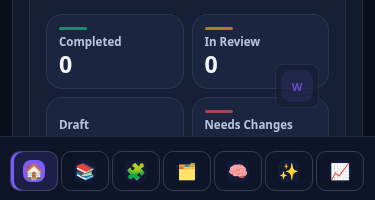
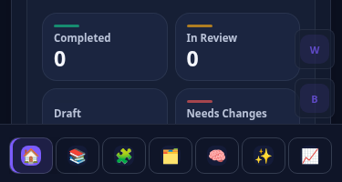

# Collapsed sidebar overflow action visibility

Base: latest merged main `537e10009ad6ff66d1488ac269589f756946e5d3`.

The controls are `#workspace-context-manage` (Workspace actions) and
`#workspace-brand-manage` (Brand actions), both `.workspace-context-manage`
buttons inside the existing identity rows in `index.html`.
`workspace-sidebar.js` owns permission-based hidden/disabled attributes, click
listeners, body-owned menus, keyboard handling and focus restoration.
`app.js` toggles the existing `.app-shell.sidebar-collapsed` class through
`setSidebarCollapsed`; responsive CSS also provides compact and mobile layouts.

A later compact CSS rule deliberately redisplayed these controls below the icons,
overriding an earlier `display:none` rule. Add only `visibility:hidden` to that
existing collapsed-state rule. This preserves the current grid slots, dimensions
and unrelated spacing while preventing pointer interaction, keyboard tab stops
and programmatic focus. Removing the collapsed class automatically restores the
original visibility, including responsive layouts. No DOM, IDs, handlers,
permissions, menu logic or state management changes.

Validation:

- Production page in Chromium with local mocked API responses: Light and Dark,
  widths 1440/1024/768/375/320, expanded → collapsed → expanded. Both controls
  retain their DOM nodes, reject focus and are skipped by Tab while collapsed.
  Both menus open again after expansion; Escape restores the originating control.
  No page errors.
- Sidebar/Workspace/Brand checks BW-36.4, BW-36.10 and BW-36.11R1 passed.
- Full Runtime Boot Safety: all 223 validation commands passed, including the
  Workspace/Brand lifecycle browser regressions, script syntax/integrity,
  Campaign, Canvas, Learning Advisor, localization and browser-global checks.
  Two CI setup commands failed locally (default npm installation and Playwright
  browser installation); dependencies were instead installed successfully using
  the writable workspace npm cache, and the suite used system Chromium. Browser
  checks ran with the network-enabled execution profile for local socket access.
- `git diff --check` passed.

## R1 — remove reserved action space

Base: latest merged main `2ca2606c4ea04851cf8fe598c3e28864b8d2697a`.
This follow-up supersedes the slot-preservation behavior above.

### Exact layout cause

`#workspace-context` is a grid with a 10px gap and two
`.workspace-context-group` children. Each group contains a hidden label and a
`.workspace-context-identity-row`, itself a grid containing the identity trigger
and the action button. The collapsed identity grid has one column. The later
`display:grid; visibility:hidden` action rule overrode the earlier `display:none`,
placing each 44px action in an implicit second row. Each group consequently
measured 88px, even though its action was invisible. There were no explicit fixed
height tracks: Chromium resolved the implicit tracks as `44px 44px`.

The group gap (10px), context border (1px each side), and bottom margin (12px)
serve the existing group separation. They do not belong to an action row and are
preserved. Collapsed context padding was already zero; group padding and margin
were also zero. The label's 4px group gap adds no space when only the identity row
participates in layout.

Mobile has additional `:has()` rules that reserve an action column and render a
Brand action-only group while hiding its identity trigger. Those wrappers must
also return to an intrinsic one-column icon stack when the collapsed class is
present.

### Scoped correction

Only `workspace-sidebar.css` changes application behavior. Collapsed action
buttons now use `display:none` with specificity sufficient to override the
mobile Brand-ID rule. Both identity groups remain available, including for
read-only roles. The collapsed mobile context uses an intrinsic-height 44px-wide
grid and restores the existing Brand identity trigger, reusing the established
10px context gap. The empty-workspace Create action keeps its existing mobile layout. Expanded rules
are untouched. No nodes, IDs, listeners,
permissions, menus, navigation, Board selection, Workspace state or Canvas code
changed.

### Chromium geometry

Full production HTML/CSS/JavaScript ran in real system Chromium with every network
request fulfilled locally. Measurements were taken after layout transitions
settled and with the pointer away from the sidebar to avoid hover transforms.
Light and Dark produced the same geometry.

| Collapsed measurement | Before | After |
| --- | ---: | ---: |
| Sidebar width at 1440/1024/768 | 74px | 74px |
| Avatar size | 32 × 32px | 32 × 32px |
| Identity target height | 44px | 44px |
| Each desktop identity group height | 88px | 44px |
| Desktop context height | 188px | 100px |
| Workspace avatar top | 123px | 123px |
| Brand avatar top | 221px | 177px |
| Avatar top-to-top distance | 98px | 54px |
| Clear gap between identity targets | 54px | 10px |
| Each action bounding box | 44 × 44px | 0 × 0px |
| Navigation top | 316px | 228px |
| Context-to-navigation gap | 12px | 12px |
| Mobile context width (375/320) | 92px | 44px |
| Mobile context intrinsic stack | Workspace + empty action slots | 44px + 10px + 44px |
| Mobile navigation top | 851px | 851px |

Mobile now shows both 32px avatars at y=738/792 inside 44px targets at y=732/786;
the context is 98px tall and ends at y=830, above the existing bottom navigation.
The desktop header geometry, internal navigation row spacing, and mobile bottom
navigation geometry remain unchanged.

Expanded → collapsed → expanded ran in both themes at 1440/1024/768/375/320,
900px high. All 20 expanded snapshots matched their pre-change bounding boxes
and computed layout exactly. Both action menus opened in every expanded snapshot;
Escape closed each and restored its originating trigger. Both collapsed action
boxes were zero-sized. Read-only roles and keyboard focus were checked separately.
No browser page errors occurred.

### Evidence

[Complete evidence archive](sidebar-spacing-r1-evidence/evidence.zip) contains all
40 before/after theme/width/mode PNGs, raw bounding boxes and computed styles,
the reproducible Chromium fixture, and Runtime Boot Safety logs/results.
Screenshots are captured directly by Chromium: desktop sidebar clips and mobile
bottom-context/navigation clips.

| Example | Before | After |
| --- | --- | --- |
| Light desktop |  |  |
| Dark mobile |  |  |

### Tests

- Focused BW-36.4, BW-36.10, BW-36.11R1 and Chromium BW-36.13R4R1 passed on the final CSS. The Chromium regression covers actual menu → rename → cancel/submit, authorization/revocation, Brand Profile entry, navigation, focus, both themes, six widths and 200% equivalent reflow.
- Geometry fixture: 60 expanded/collapsed/re-expanded captures across before/after; 40 unique PNGs; all 20 expanded before/after snapshots match exactly. Read-only roles, hidden-action Tab behavior and empty-workspace mobile creation passed.
- Runtime Boot Safety: all 223 workflow validation commands were exercised. 222 passed on the initial run. BW-36.19R7 initially failed its Advisor button contrast assertion (3.964 versus 4.5); an unchanged rerun passed all 48 Advisor captures and contrast/accessibility assertions. That isolated fixture loads only styles.css, brand-learnings.css and learning-advisor.css, never workspace-sidebar.css. The initial failure and successful retry logs are both retained; no unrelated code was changed.
- Dependencies installed successfully with a writable workspace npm cache. System Chromium 151.0.7922.173 substituted for the workflow browser download; both setup commands are excluded from the 223 validation-command count.
- `git diff --check` passed.
